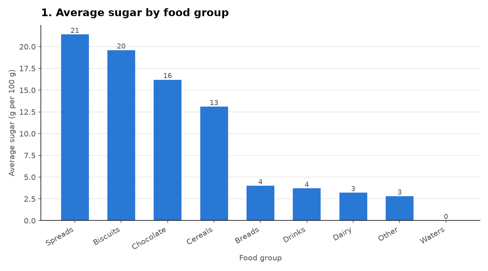
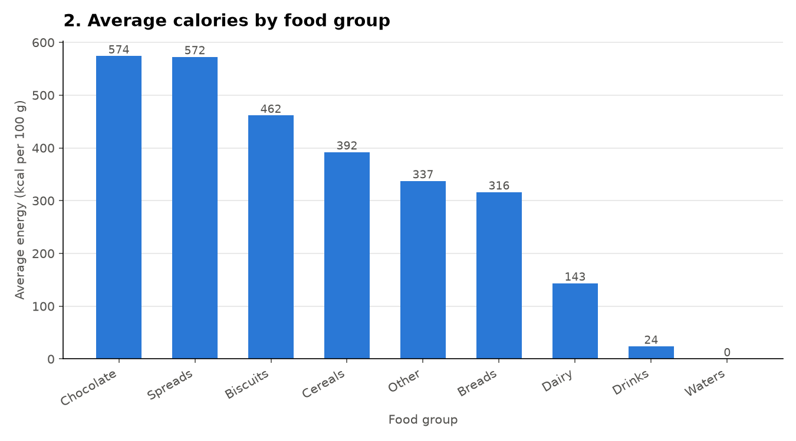
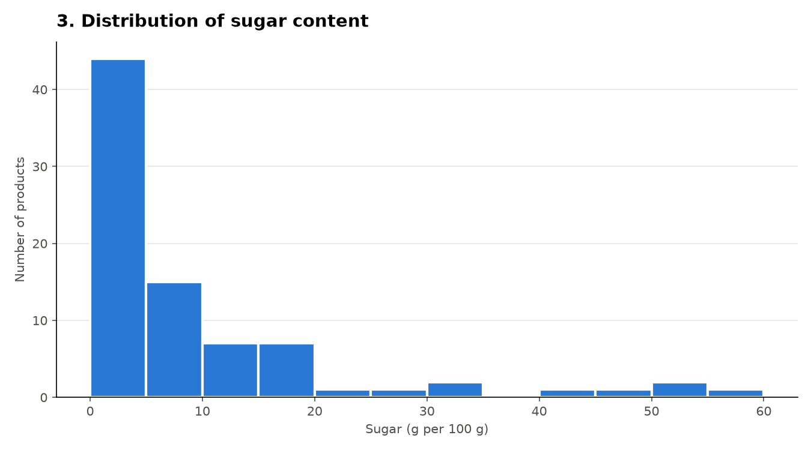
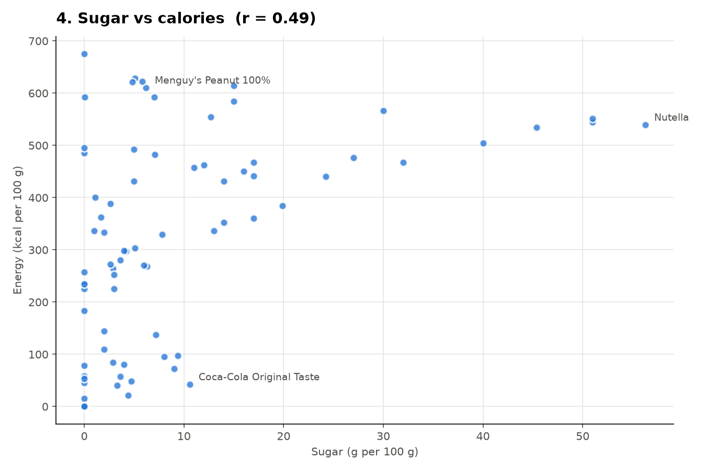
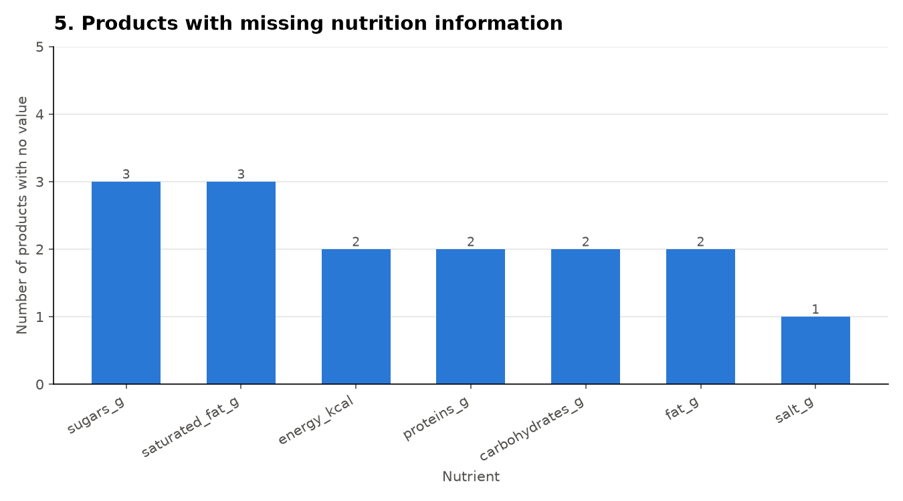

# NutriScan 🥗

NutriScan is a data analysis project that collects nutrition information about packaged food products, cleans and validates the data, stores it in a database, and explores it through statistical analysis and visualizations.

The data comes from [Open Food Facts](https://world.openfoodfacts.org/), a free and open database of food products from around the world.

> All nutrition values are per 100 g (or 100 ml) of a product, allowing different foods to be compared fairly. This project is intended for data analysis and does not provide medical or dietary advice.

---

## What the Project Does

NutriScan follows an ETL (Extract, Transform, Load) workflow, followed by Exploratory Data Analysis (EDA).

The project works in four main steps:

1. **Extract:** Collects food product information from the Open Food Facts API.
2. **Clean and Validate:** Removes duplicates, handles missing values, and validates the collected data.
3. **Load:** Stores the cleaned data in an SQLite database.
4. **Analyze:** Explores the data using statistics, comparisons, and visualizations.

| Step       | File                | What It Does                                                                                                                                                                                      |
| ---------- | ------------------- | ------------------------------------------------------------------------------------------------------------------------------------------------------------------------------------------------- |
| 1. Extract | `extract_data.py`   | Fetches 100 food products from the Open Food Facts API and saves them in `raw_food_data.csv`.                                                                                                     |
| 2. Clean   | `clean_validate.py` | Cleans and validates the raw data, removes duplicates and invalid records, and creates `cleaned_food_data.csv`.                                                                                   |
| 3. Load    | `load_database.py`  | Loads the cleaned data into the SQLite database `nutriscan.db`, checks the row count, and executes example SQL queries.                                                                           |
| 4. EDA     | `eda_analysis.py`   | Calculates statistics, compares food groups, examines the relationship between sugar and calories, identifies missing values, and generates five graphs and summary tables inside `eda_outputs/`. |

---

## Folder Structure

```text
Nutriscan/
│
├── README.md
├── requirements.txt
├── .gitignore
│
├── extract_data.py
├── clean_validate.py
├── load_database.py
├── eda_analysis.py
│
├── raw_food_data.csv
├── cleaned_food_data.csv
├── rejected_food_data.csv
├── nutriscan.db
│
└── eda_outputs/
    ├── 1_avg_sugar_by_group.png
    ├── 2_avg_calories_by_group.png
    ├── 3_sugar_distribution.png
    ├── 4_sugar_vs_calories.png
    ├── 5_missing_values.png
    ├── descriptive_statistics.csv
    ├── averages_by_food_group.csv
    ├── top_products.csv
    └── missing_values.csv
```

---

## Data Columns

Each product in `cleaned_food_data.csv` and the SQLite database contains the following information:

| Column            | Description                                                              |
| ----------------- | ------------------------------------------------------------------------ |
| `product_code`    | Unique barcode of the product, stored as text to preserve leading zeros. |
| `product_name`    | Name of the food product.                                                |
| `brand`           | Brand name of the product.                                               |
| `category`        | Food category labels from Open Food Facts.                               |
| `energy_kcal`     | Energy in kilocalories per 100 g.                                        |
| `sugars_g`        | Sugar content in grams per 100 g.                                        |
| `proteins_g`      | Protein content in grams per 100 g.                                      |
| `carbohydrates_g` | Carbohydrate content in grams per 100 g.                                 |
| `fat_g`           | Total fat in grams per 100 g.                                            |
| `saturated_fat_g` | Saturated fat in grams per 100 g.                                        |
| `salt_g`          | Salt content in grams per 100 g.                                         |
| `ingredients`     | Ingredients information of the product.                                  |
| `nutrition_grade` | Nutri-Score grade (A = best, E = worst).                                 |

Missing information is kept as empty values rather than being replaced with zero. This distinction is important because a missing value does not necessarily mean that a product contains none of that nutrient.

---

## How to Run the Project

### 1. Install Python

Python 3.10 or newer is required.

Check your Python version:

```bash
python --version
```

### 2. Download the Project

Clone the GitHub repository:

```bash
git clone https://github.com/Maham011/nutriscan.git
cd Nutriscan
```

### 3. Install Required Libraries

```bash
pip install -r requirements.txt
```

The project uses Requests, Pandas, SQLAlchemy, Matplotlib, and Pydantic.

### 4. Run the Project

Run all commands from the main `Nutriscan` directory:

```bash
# Step 1: Extract raw data from Open Food Facts
python extract_data.py

# Step 2: Clean and validate the raw data
python clean_validate.py

# Step 3: Load the cleaned data into SQLite
python load_database.py

# Step 4: Perform exploratory data analysis
python eda_analysis.py
```

**Note:**

- Step 1 requires an internet connection to retrieve fresh product data from the Open Food Facts API.
- If the raw and cleaned CSV files are already available, they can be used instead of retrieving and processing the data again.
- The database can be rebuilt by running `load_database.py`.
- The EDA script uses the SQLite database when available; otherwise, it can read the cleaned CSV file.

---

## Main Findings

The analysis was performed on 85 cleaned food products and revealed the following observations:

- **Spreads and biscuits** have the highest average sugar content, at approximately 21 g and 20 g per 100 g, respectively.
- **Spreads and chocolate** have among the highest average calorie values, at approximately 570 kcal per 100 g.
- **Waters** contain no recorded sugar and calories in the analyzed dataset.
- Sugar and calories show a **moderate positive correlation (r = 0.49)**. This relationship is not stronger because other nutrients, particularly fat, also contribute to calorie content. Fat provides approximately 9 kcal per gram, while sugar provides approximately 4 kcal per gram.

For example, peanut butter can contain relatively little sugar while still having a high calorie content because of its fat content.

### Graphs and Visualizations

| Average Sugar by Food Group                                          | Average Calories by Food Group                                             |
| -------------------------------------------------------------------- | -------------------------------------------------------------------------- |
|  |  |

| Sugar Distribution                                          | Sugar vs Calories                                         |
| ----------------------------------------------------------- | --------------------------------------------------------- |
|  |  |

### Missing Values



---

## Tools and Technologies Used

| Tool                                                 | Purpose                                                          |
| ---------------------------------------------------- | ---------------------------------------------------------------- |
| [Python](https://www.python.org/)                    | Main programming language used for the project.                  |
| [Requests](https://requests.readthedocs.io/)         | Fetching product information from the Open Food Facts API.       |
| [Pandas](https://pandas.pydata.org/)                 | Data cleaning, processing, tables, and statistical calculations. |
| [SQLAlchemy](https://www.sqlalchemy.org/) and SQLite | Database creation, storage, and SQL queries.                     |
| [Matplotlib](https://matplotlib.org/)                | Creating graphs and data visualizations.                         |
| [Pydantic](https://docs.pydantic.dev/)               | Data validation and checking data structures.                    |

---

## Team Contributions

This project was developed by a team of four students, with each member contributing to a different stage of the data pipeline.

| Team Member | Contribution                                     |
| ----------- | ------------------------------------------------ |
| Person 1    | Data extraction using the Open Food Facts API.   |
| Person 2    | Data cleaning and validation.                    |
| Person 3    | Database creation and data storage using SQLite. |
| Person 4    | Exploratory data analysis and visualization.     |

---

## Data Source and Licence

The product information used in this project was obtained from [Open Food Facts](https://world.openfoodfacts.org/).

Open Food Facts data is available under the [Open Database License (ODbL)](https://opendatacommons.org/licenses/odbl/1-0/).
